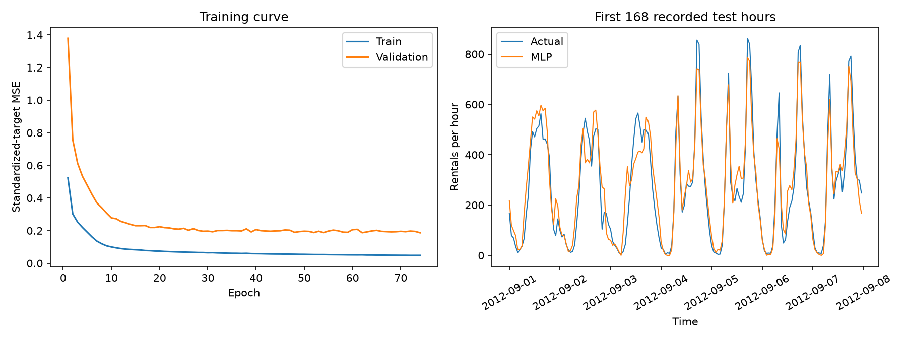
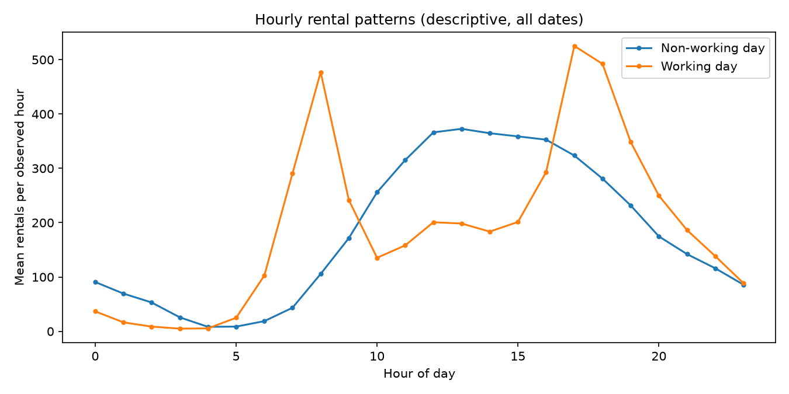

# Bike Demand · PostgreSQL + PyTorch

基于 UCI 共享单车小时数据的需求预测与数据库分析项目。使用 PostgreSQL 完成数据存储、关联与指标核对，使用 PyTorch MLP 估计给定日历、气象条件下的小时租车量，并将测试预测回写数据库。

## 实验结果

原始文件包含 **17,379 条小时记录**。按时间划分训练、验证、测试集：13,003 / 1,488 / 2,888 条；模型权重仅根据验证集 MAE 选择。

| 方法 | 测试 MAE（次/小时） | 测试 RMSE（次/小时） |
|---|---:|---:|
| 训练集总体均值 | 171.19 | 229.43 |
| 工作日＋小时分组均值 | 101.91 | 147.06 |
| MLP | **52.70** | **76.34** |

MLP 相比分组均值基线的 MAE 降低 **48.29%**。基线统计量仅来自训练集；SQL 回查所得 MAE 与 Python 一致。该基线不使用天气和年度增长特征，结果不等同于相对线性或树模型的优势。



完整结果见 [实验报告](artifacts/RESULTS.md)、[指标与版本](artifacts/metrics.json)、[验证记录](artifacts/VALIDATION.md)。

## 数据流程

```text
UCI CSV → 数据校验 → PostgreSQL → SQL JOIN / 分组统计
                                  ↓
                         pandas / NumPy 特征处理
                                  ↓
                         PyTorch MLP → 留出集评估
                                  ↓
                    预测回写 PostgreSQL → SQL 复核 MAE
```

数据库包含四张表，统一位于 `bike_project` schema：

| 表 | 内容 | 主键 |
|---|---|---|
| `hourly_conditions` | 日历与观测气象特征 | `observed_at` |
| `hourly_demand` | 小时实际租车次数 | `observed_at` |
| `model_runs` | 训练配置与评估指标 | `run_id` |
| `predictions` | 每次实验的测试预测与基线预测 | `(run_id, observed_at)` |

## 运行

环境：Python 3.11+、PostgreSQL。参考实验使用 PostgreSQL 18.6 和 CPU PyTorch；具体版本记录在 `artifacts/metrics.json`。

先创建数据库 `bike_demand`，或通过 `PGDATABASE` 指定已有数据库。项目脚本会建立专用 schema 和表。

Windows PowerShell：

```powershell
python -m venv .venv
.\.venv\Scripts\python.exe -m pip install -r requirements.txt

$env:PGHOST = '127.0.0.1'
$env:PGPORT = '5432'
$env:PGDATABASE = 'bike_demand'
$env:PGUSER = 'postgres'

.\.venv\Scripts\python.exe run_all.py
```

Linux/macOS：

```bash
python3 -m venv .venv
.venv/bin/python -m pip install -r requirements.txt
export PGHOST=127.0.0.1 PGPORT=5432 PGDATABASE=bike_demand PGUSER=postgres
.venv/bin/python run_all.py
```

未设置 `PGPASSWORD` 时，程序交互读取密码，不回显、不写入文件。数据已附带在 `data/hour.csv`；文件缺失时会从 UCI 下载，并验证 SHA-256。

各阶段也可单独执行：

```powershell
.\.venv\Scripts\python.exe load_data.py
.\.venv\Scripts\python.exe analyze.py
.\.venv\Scripts\python.exe train.py
.\.venv\Scripts\python.exe predict.py --at '2012-12-30 17:00:00'
```

重复导入同一份数据不会增加重复记录；重新训练会新增数据库实验记录，并更新 `artifacts/` 中的模型和报告。代码使用参数绑定执行带条件查询，不拼接用户输入。

## 模型与评估

- 特征：6 个数值/二元特征，以及小时、星期、月份、天气类别的固定 one-hot 编码，共 53 维。
- 网络：`Linear(53,64) → ReLU → Linear(64,32) → ReLU → Linear(32,1)`，5,569 个参数。
- 训练：标准化标签上的 MSE、SGD、学习率 0.03、batch size 256、最多 180 个 epoch。
- 模型选择：连续 20 个 epoch 验证 MAE 未改善则停止，恢复验证 MAE 最低的权重。
- 时间边界：训练 `<2012-07-01`，验证 `[2012-07-01,2012-09-01)`，测试 `>=2012-09-01`。
- 预处理：标准化参数和基线均值仅从训练集拟合；推理复用保存的参数和特征顺序。
- 泄漏防护：`casual + registered = cnt`，前两列不进入数据库条件表和模型输入。
- 评估：测试集 MAE、RMSE，以及工作日/小时分组误差；数据库保存预测后用 SQL 独立复核。



## 文件结构

```text
load_data.py / analyze.py / train.py / predict.py / run_all.py
project_lib.py             数据管道、特征处理、网络、评估与推理
sql/                      建表、质量检查、分析、训练取数和指标复核
tests/                    数据检查与数据库/模型集成测试
data/                     原始数据及来源署名
artifacts/                参考实验指标、图表、权重与逐小时预测
```

## 验证

```powershell
.\.venv\Scripts\python.exe -m unittest discover -s tests -v
```

默认运行 5 项输入检查，跳过 5 项数据库集成检查。集成检查需指定已完整运行本项目的独立测试数据库，并设置 `BIKE_TEST_DB=1`。集成检查覆盖时间切分、JOIN 行数、泄漏字段隔离、数据库约束、SQL 指标和权重恢复一致性。

## 数据与适用范围

数据来自 [UCI Bike Sharing](https://archive.ics.uci.edu/dataset/275/bike+sharing+dataset)，作者 Fanaee-T (2013)，许可为 **CC BY 4.0**，详见 [数据来源](data/SOURCE.md)。

天气为当小时实测值，因此本项目属于历史条件下的离线需求估计；提前预测需要预测时可获得的天气预报与重新回测。数据不含站点库存或车辆轨迹，输出为系统级小时需求。原始时间范围内有 165 个未记录小时，没有将它们直接填为零。

结果只对应一次固定时间留出评估，不代表生产收益或跨城市泛化能力。小时记录具有时间相关性，未按独立观测假设为误差构造置信区间。全量日期的图表仅作描述性展示，不参与模型参数拟合。
